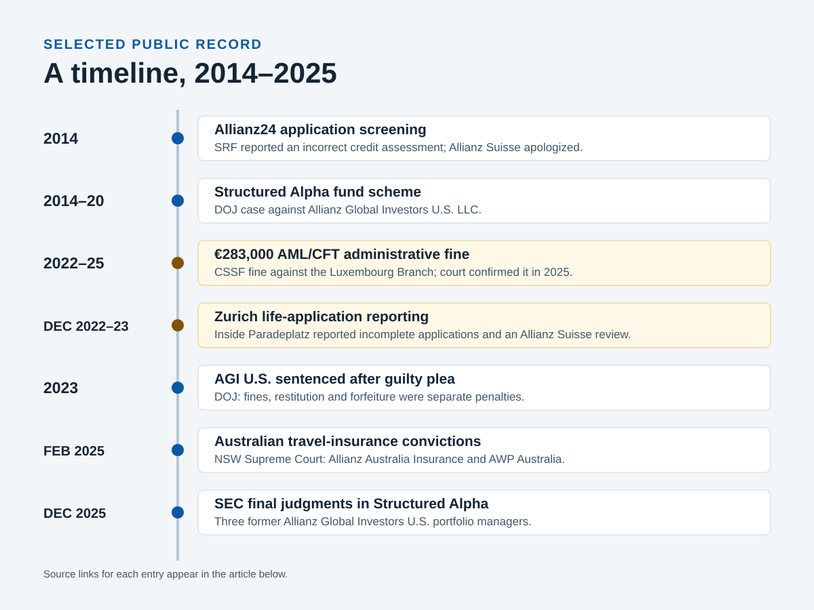
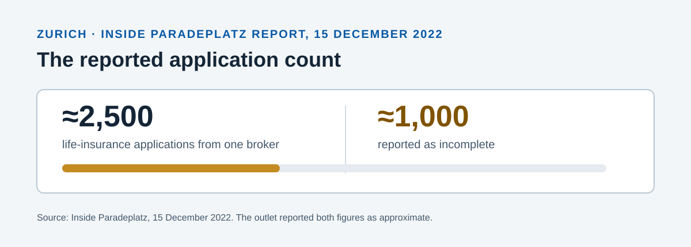

# Allianz Laundry

> A generated, evidence-graded review built from the same research file is in
> [`generated/allianz-conduct-review.md`](generated/allianz-conduct-review.md).
> It keeps each record's evidence class, links a numbered source register and
> includes company responses and an explicit limitations section.

### Enforcement records, Swiss insurance reporting and company statements

The public record includes a U.S. securities-fraud guilty plea, an AML/CFT control sanction in Luxembourg, Australian insurance convictions and Swiss reporting about Allianz Suisse. This article names the entity and source for each item.

## Switzerland: the Zurich applications story

On 15 December 2022, Inside Paradeplatz reported that about 1,000 of roughly 2,500 life-insurance applications submitted through a Zurich general agency by one broker were incomplete. The outlet reported that two interns filled missing fields and a manager signed the applications. [Inside Paradeplatz's report](https://insideparadeplatz.ch/2022/12/15/allianz-erschuettert-von-1000-fake-lebens-antraegen/)

The same article quoted an Allianz spokesperson as saying the broker relationship was no longer active, Allianz was reviewing compliance with internal rules, and it had no indication of money laundering. A 19 December follow-up quoted Allianz Suisse as saying no customers had been harmed and that it would not comment beyond its existing statement. That follow-up also attributed earlier management awareness to unnamed sources. [Inside Paradeplatz, 19 December 2022](https://insideparadeplatz.ch/2022/12/19/skandal-bei-allianz-suisse-ceo-geraet-in-fokus/)

On 23 January 2023, Inside Paradeplatz reported that the Zurich general agent would leave at the end of January and quoted Allianz as saying the parties had agreed to end their relationship. The article repeated its reporting about incomplete applications and raised questions about when head-office managers learned of them. [Inside Paradeplatz, 23 January 2023](https://insideparadeplatz.ch/2023/01/23/erdbeben-bei-allianz-suisse-zuerich-generalagent-raus/)

## Switzerland: Allianz24 credit screening

In 2014, SRF reported that Allianz24, Allianz Suisse's online motor insurer, rejected an applicant after an external credit check found unpaid bills belonging to other people with the same name. SRF quoted an Allianz Suisse spokesperson who said a review found no objective reason for the refusal, called it an error and apologized. The spokesperson also said Allianz did not keep a blacklist based on names or nationality, while it did keep a list of former customers with negative experiences. [SRF, 6 November 2014](https://www.srf.ch/sendungen/kassensturz-espresso/versicherungen-sorry-keine-versicherung-mit-ihrem-namen)

## Luxembourg: AML/CFT controls

The CSSF imposed a €283,000 administrative fine on **Allianz Global Investors GmbH, Zweigniederlassung Luxembourg** on 25 March 2022 for professional-obligation breaches concerning the prevention of money laundering and terrorist financing. The Luxembourg Administrative Court confirmed all aspects of the sanction on 7 February 2025. The CSSF's published findings include an incomplete risk analysis, investor due-diligence and monitoring gaps, missing management approval for intermediary files, incomplete screening evidence and an insufficient internal-audit cycle. [CSSF decision page](https://www.cssf.lu/en/Document/administrative-sanction-of-25-march-2022/) · [CSSF decision PDF](https://www.cssf.lu/wp-content/uploads/S_88_GFI_Allianz_Global_Investors_GmbH_Zweigniederlassung_Luxembourg_2022.03.25_en.pdf)

## United States: Structured Alpha

Allianz Global Investors U.S. LLC pleaded guilty to one count of securities fraud for conduct involving its Structured Alpha funds from 2014 through March 2020. The Department of Justice said AGI U.S. understated investment risks, misrepresented hedges and risk controls, and altered investor documents. The funds held more than $11 billion at their peak. [DOJ sentencing release, 12 July 2023](https://www.justice.gov/usao-sdny/pr/allianz-global-investors-us-sentenced-connection-multibillion-dollar-fraud-scheme) · [DOJ court-filed Information](https://www.justice.gov/usao-sdny/press-release/file/1506881/dl)

The sentence included more than $2.33 billion in fines, more than $3.23 billion in restitution and more than $463 million in forfeiture. DOJ separately reported more than $5 billion in civil settlements. These amounts describe different penalties and settlements.

On 5 December 2025, the SEC announced final judgments against former AGI U.S. portfolio managers Gregoire Tournant, Trevor Taylor and Stephen Bond-Nelson. The release says the judgments included industry bars; Tournant consented without admitting or denying the SEC complaint's allegations. [SEC Litigation Release 26432](https://www.sec.gov/enforcement-litigation/litigation-releases/lr-26432)

## Australia: travel-insurance statements

On 28 February 2025, the Supreme Court of New South Wales convicted Allianz Australia Insurance Limited on six counts and AWP Australia Pty Ltd on one count of disseminating false or misleading information about travel insurance. The court found the companies' online information between 2016 and 2018 overstated available cover by omitting limits, terms and exclusions. The court imposed criminal fines of AUD 13.5 million on Allianz Australia Insurance and AUD 3.3 million on AWP Australia. [ASIC's outcome notice](https://www.asic.gov.au/about-asic/news-centre/find-a-media-release/2025-releases/25-028mr-allianz-and-awp-convicted-and-fined-168-million-for-making-false-or-misleading-statements) · [NSW Supreme Court judgment](https://www.caselaw.nsw.gov.au/decision/19549dffb4413e29a3aaf0bd)

## Allianz Suisse's published HIS rules

Allianz Suisse's HIS disclosure says an entry by itself cannot be the sole reason to deny an insurance benefit. It lists the reasons for entries, the process for requesting correction or deletion, and automatic deletion seven years after the claim date. [Allianz Suisse HIS policy](https://www.allianz.ch/en/information/his.html)

## Source collection

The dashboard's **Collected sources** view downloads the named source links in the research file and stores an excerpt, retrieval date and document hash. A source that rejects automated access remains visible with its official link and access status.

The **Evidence checks** view compares each finding with its collected excerpt: it distinguishes a primary outcome from a reported allegation, flags a confirmed outcome whose excerpt contains no outcome wording, and lists wrongdoing signals in a source that no record yet covers. These are review leads, not additional findings.
