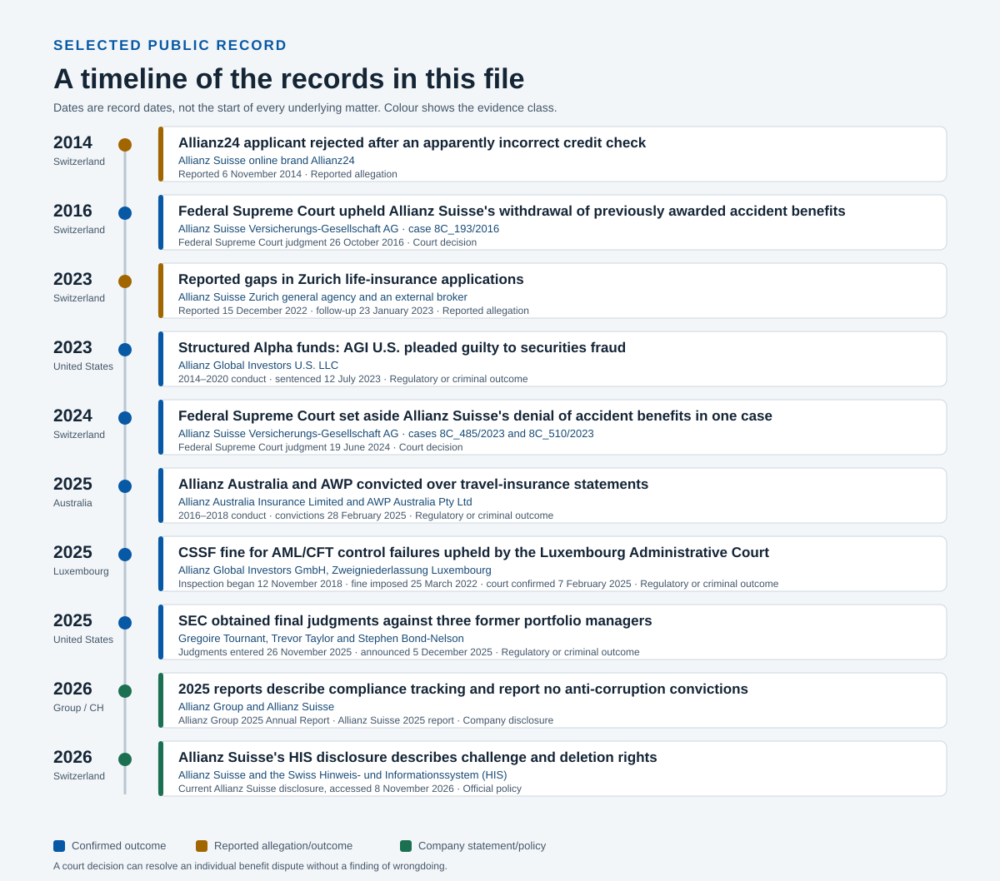
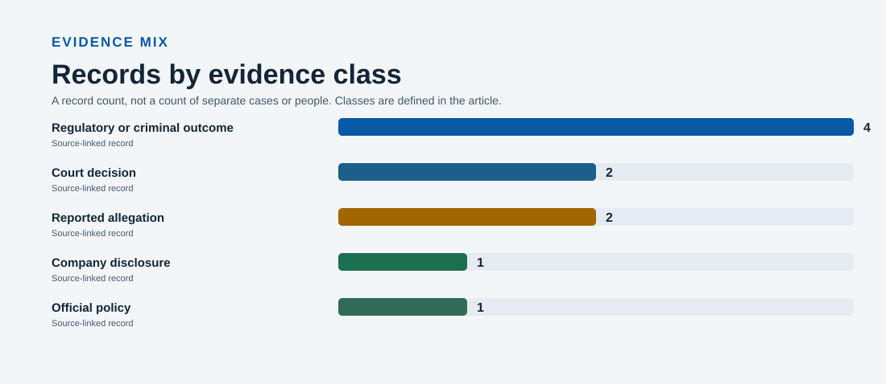
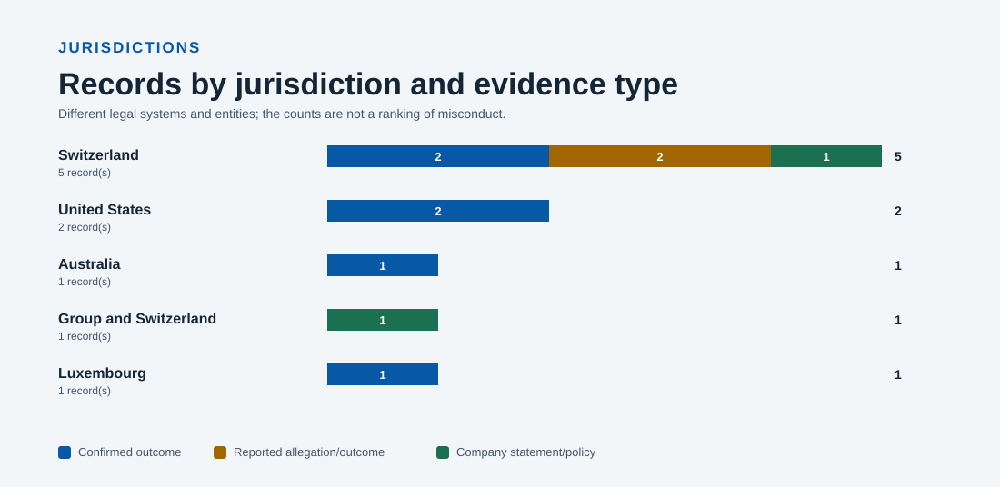

# Allianz: a source-linked review of selected conduct records

*Selected regulatory, court, company and reported records concerning Allianz entities and related matters, grouped by jurisdiction and kept distinct by evidence class.*

Generated 11 November 2026 at 12:33 UTC · Research file reviewed 8 November 2026 · 10 records · 16 cited sources

> **How to read this file.** Every record keeps its evidence class. A published regulatory or court outcome is reported as the authority published it; a reported allegation is attributed to the outlet that published it and is not presented as a proven fact. Company statements are labelled as company statements. The internal appendix is not evidence.

## At a glance

- **10** records across **5** sections.
- **4** regulatory or criminal outcomes and **2** court decisions.
- **2** reported allegations and **0** reported court outcomes.
- **1** company disclosure and **1** official policy.
- **16** cited sources, of which **12** are marked primary.

## The record at a glance

*Figure 1. Selected records by date. Blue marks a confirmed regulatory or criminal outcome, amber a reported allegation or reported outcome, and green a company statement or policy.*

*Figure 2. Records by evidence class. Counts describe records in this file, not separate cases.*

*Figure 3. Records by jurisdiction, split by confirmed outcomes, reported allegations and company statements. The chart is not a ranking of misconduct.*

## Evidence classes in this file

| Evidence class | What it means | Records |
| --- | --- | --- |
| Regulatory or criminal outcome | A regulator or court published this outcome. | 4 |
| Court decision | A court's written decision in the listed case. | 2 |
| Reported allegation | A claim attributed to a news report; not an established fact. | 2 |
| Reported court outcome | A court outcome described by a news report. | 0 |
| Company disclosure | Information published by Allianz about itself. | 1 |
| Official policy | A policy or disclosure published by Allianz. | 1 |

A record count is not a count of cases. One case can generate several records, and a court decision can resolve an individual benefit dispute without a finding of wrongdoing.

## The records

The records are grouped by the jurisdiction named in the research file and ordered by date. Each heading is a record, not a separate allegation or case. Source numbers refer to the register at the end of this file.

### United States

This section contains 2 records: 2 regulatory or criminal outcomes.

#### Structured Alpha funds: AGI U.S. pleaded guilty to securities fraud

- **Entity:** Allianz Global Investors U.S. LLC
- **Date:** 2014–2020 conduct · sentenced 12 July 2023
- **Evidence class:** Regulatory or criminal outcome (published outcome)

The DOJ said AGI U.S. concealed fund downside risks, misrepresented hedging and altered investor materials. It pleaded guilty to one count of securities fraud and was sentenced in 2023.

- The funds held more than USD 11 billion in assets at their peak.
- The sentence included more than USD 2.33 billion in fines, USD 3.23 billion in restitution and more than USD 463 million in forfeiture.
- The DOJ separately reported civil settlements of more than USD 5 billion. These figures are kept separate and are not added together here.

**Sources:** [1](#source-1) [2](#source-2) [3](#source-3)

#### SEC obtained final judgments against three former portfolio managers

- **Entity:** Gregoire Tournant, Trevor Taylor and Stephen Bond-Nelson
- **Date:** Judgments entered 26 November 2025 · announced 5 December 2025
- **Evidence class:** Regulatory or criminal outcome (published outcome)

The SEC reported final civil judgments and industry bars connected to the Structured Alpha scheme. Tournant had separately pleaded guilty to investment-adviser fraud.

- The SEC says investors placed about USD 11 billion into Structured Alpha and that investor materials were manipulated to conceal risk.
- The judgments followed parallel criminal proceedings. The SEC release reports forfeiture amounts for each manager.

**Sources:** [4](#source-4)

### Luxembourg

This section contains 1 record: 1 regulatory or criminal outcome.

#### CSSF fine for AML/CFT control failures upheld by the Luxembourg Administrative Court

- **Entity:** Allianz Global Investors GmbH, Zweigniederlassung Luxembourg
- **Date:** Inspection began 12 November 2018 · fine imposed 25 March 2022 · court confirmed 7 February 2025
- **Evidence class:** Regulatory or criminal outcome (published outcome)

The CSSF imposed a EUR 283,000 administrative fine after finding persistent deficiencies in the branch's anti-money-laundering and counter-terrorist-financing framework. The Administrative Court confirmed all aspects of the sanction in 2025.

- The CSSF cited an incomplete activity-wide risk analysis, gaps in investor due diligence and ongoing monitoring, missing management approval for intermediary files, incomplete screening evidence, and an insufficient internal audit cycle.

**Sources:** [5](#source-5) [6](#source-6)

### Australia

This section contains 1 record: 1 regulatory or criminal outcome.

#### Allianz Australia and AWP convicted over travel-insurance statements

- **Entity:** Allianz Australia Insurance Limited and AWP Australia Pty Ltd
- **Date:** 2016–2018 conduct · convictions 28 February 2025
- **Evidence class:** Regulatory or criminal outcome (published outcome)

The NSW Supreme Court convicted the companies after misleading online information overstated the travel-insurance benefits available without adequately presenting sub-limits, terms and exclusions.

- The court imposed criminal fines of AUD 13.5 million on Allianz Australia and AUD 3.3 million on AWP Australia.
- ASIC said the conduct exposed thousands of customers to a risk of misunderstanding their cover.

**Sources:** [7](#source-7)

### Switzerland

This section contains 5 records: 2 court decisions, 2 reported allegations, 1 official policy.

#### Allianz24 applicant rejected after an apparently incorrect credit check

- **Entity:** Allianz Suisse online brand Allianz24
- **Date:** Reported 6 November 2014
- **Evidence class:** Reported allegation (reported claim — not a finding)

SRF reported that an applicant was refused motor insurance after a creditworthiness check appeared to associate her with debts belonging to people with the same name. An Allianz spokesperson told SRF there were no objective grounds for the decision and apologised for an error.

*This is a reported claim attributed to the named publication. It is not a finding by a court or regulator, and the underlying documents were not independently reviewed here.*

- Allianz denied operating a blacklist based on nationality or name.
- The source reports that Allianz maintained a list of former customers with negative experiences.

**Sources:** [8](#source-8)

#### Federal Supreme Court upheld Allianz Suisse's withdrawal of previously awarded accident benefits

- **Entity:** Allianz Suisse Versicherungs-Gesellschaft AG · case 8C\_193/2016
- **Date:** Federal Supreme Court judgment 26 October 2016
- **Evidence class:** Court decision (court record)

After Allianz had taken over the case from SUVA and paid benefits retroactively, it later withdrew the award after receiving documents from the at-fault driver's liability insurer. The Federal Supreme Court allowed Allianz's appeal and confirmed its denial.

- The claimant had earlier received an invalidity pension and other benefits under decisions issued by SUVA and then Allianz.
- The Court's 2016 judgment reversed the cantonal judgment that had ordered Allianz to continue payments.

**Sources:** [9](#source-9)

#### Reported gaps in Zurich life-insurance applications

- **Entity:** Allianz Suisse Zurich general agency and an external broker
- **Date:** Reported 15 December 2022 · follow-up 23 January 2023
- **Evidence class:** Reported allegation (reported claim — not a finding)

Inside Paradeplatz reported that about 1,000 of roughly 2,500 applications from one broker were incomplete and that agency staff filled missing fields. The article said Allianz Suisse opened an internal compliance review and had ended the broker relationship.

*This is a reported claim attributed to the named publication. It is not a finding by a court or regulator, and the underlying documents were not independently reviewed here.*

- The report attributes the application counts and the account of a whistleblower alert to its sources. They have not been independently verified here.
- A follow-up raised questions about what senior managers knew. Those claims remain unverified in the sources reviewed.

**Sources:** [10](#source-10) [11](#source-11) [12](#source-12)

#### Federal Supreme Court set aside Allianz Suisse's denial of accident benefits in one case

- **Entity:** Allianz Suisse Versicherungs-Gesellschaft AG · cases 8C\_485/2023 and 8C\_510/2023
- **Date:** Federal Supreme Court judgment 19 June 2024
- **Evidence class:** Court decision (court record)

The Federal Supreme Court held that Allianz Suisse owed accident-insurance benefits for a 2020 injury and set aside the prior cantonal judgment and Allianz's contrary decision.

- The judgment concerned the insurance status of a part-time employee who also worked as a self-employed farmer.
- The Court allowed the claim and ordered the cantonal proceedings' costs and compensation to be reassessed.

**Sources:** [13](#source-13)

#### Allianz Suisse's HIS disclosure describes challenge and deletion rights

- **Entity:** Allianz Suisse and the Swiss Hinweis- und Informationssystem (HIS)
- **Date:** Current Allianz Suisse disclosure, accessed 8 November 2026
- **Evidence class:** Official policy (company policy)

Allianz says an HIS entry alone cannot justify refusing a claim. Its disclosure lists the grounds for an entry, individual access and correction routes, and automatic deletion seven years after the loss date.

- The company says entries can be challenged if the legal grounds are absent or the data are incorrect.
- The policy also describes data shared with the HIS operator and the system's role in claim review.

**Sources:** [14](#source-14)

### Group and Switzerland

This section contains 1 record: 1 company disclosure.

#### 2025 reports describe compliance tracking and report no anti-corruption convictions

- **Entity:** Allianz Group and Allianz Suisse
- **Date:** Allianz Group 2025 Annual Report · Allianz Suisse 2025 report
- **Evidence class:** Company disclosure (company statement)

Allianz Group's 2025 Annual Report describes its Supervisory Proceedings Database, which includes criminal proceedings against Allianz personnel related to work and proceedings against group subsidiaries. Its anti-corruption and anti-bribery table shows dashes for convictions and fines in 2024 and 2025.

- Allianz Suisse's 2025 financial-condition report identifies the Swiss entities and describes corporate governance and risk controls.

**Sources:** [15](#source-15) [16](#source-16)

## Responses, denials and company statements

This section reproduces positions already recorded in the file. A response is shown only where the record attributes it to Allianz or one of its representatives; where no response is recorded, none is asserted. Company disclosures and policies are the company's own descriptions, not independent verification. The passages are not an endorsement and do not resolve the underlying claims.

### Responses and denials recorded

- **Allianz Suisse online brand Allianz24** — An Allianz spokesperson told SRF there were no objective grounds for the decision and apologised for an error. [8](#source-8)
- **Allianz Suisse online brand Allianz24** — Allianz denied operating a blacklist based on nationality or name. [8](#source-8)

### Company statements

- **Allianz Group and Allianz Suisse** — Allianz Group's 2025 Annual Report describes its Supervisory Proceedings Database, which includes criminal proceedings against Allianz personnel related to work and proceedings against group subsidiaries. Its anti-corruption and anti-bribery table shows dashes for convictions and fines in 2024 and 2025. [15](#source-15) [16](#source-16) *(Company disclosure)*
- **Allianz Suisse and the Swiss Hinweis- und Informationssystem (HIS)** — Allianz says an HIS entry alone cannot justify refusing a claim. Its disclosure lists the grounds for an entry, individual access and correction routes, and automatic deletion seven years after the loss date. [14](#source-14) *(Official policy)*

## Source coverage

Coverage is reported rather than assumed. At the time of writing, the collector had retrieved a usable snapshot for **10 of 16** cited sources; **6** did not return one. **2 of 10** records are supported by a primary outcome in the collected text, and **6** carry a review flag.

A missing snapshot is a gap in this review, not evidence that the source does not exist. Every source remains linked in the register. The internal appendix lists the affected records.

## Scope and open questions

This is a selected review, not a complete inventory of every Allianz entity or matter. The research plan records the following open lines of inquiry; none is treated as a finding above.

- **Historical Swiss front-running report, 2000–2001** — Source verification open.
- **Zurich life-insurance application reporting and outcome** — Reporting collected; public outcome search open.
- **FINMA enforcement records** — Database pages collected; case-level audit in progress.
- **SEC EDGAR search** — Structured Alpha records reviewed; broader search open.
- **DOJ corporate proceedings** — Structured Alpha reviewed; broader search open.
- **Allianz directors’ dealings and executive disclosures** — Record-level review in progress.
- **Violation Tracker Global** — Not yet reviewed.
- **Swiss Federal Supreme Court and claims-handling records** — Selected decisions reviewed; 2010–2026 expansion open.
- **Swiss credit screening, personal data and HIS** — One reported incident and current policy reviewed; case search open.

## What this file does not establish

- A **reported allegation** is a claim attributed to its publisher, not a proven fact.
- An enforcement outcome or court decision concerns the **named entity and matter**, not every company in the Allianz group.
- A court decision can concern an individual benefit dispute without any finding of misconduct.
- Amounts reported in different matters are **not added together** here; fines, restitution, forfeiture and settlements are different legal categories.
- Missing, blocked or uncollected sources can leave gaps. The internal publication checks list them; an absence of records is not evidence that other conduct did not occur.
- Automated wrongdoing signals and evidence checks are **review aids**, not evidence.

## Method and limitations

This draft is generated from the research file's 10 records and the named sources attached to them. It adds no new reporting and no unnamed sourcing.

- Each record keeps its original evidence class, entity and source links.
- Primary regulator, court and company documents are kept distinct from secondary reporting.
- Dates and amounts are reproduced as recorded; they are not normalised across jurisdictions.
- The source collector is an on-demand job that fetches named sources. It does not discover new URLs, and a blocked source remains visible with its access status.
- The figures are generated from record metadata. This article uses no stock photography, illustrative reconstructions or AI-generated imagery.
- Research file last reviewed: 8 November 2026.

Generated on 11 November 2026 at 12:33 UTC with the ms-conduct article writer.

## Appendix: publication checks (internal)

*Remove this appendix before publication. It records automated review signals, not additional findings.*

Dossier integrity: 0 error(s), 0 warning(s), 1 info item(s). Records supported by a primary outcome: 2/10.

| Record | Evidence class | Review status | Sources collected | Review flags |
| --- | --- | --- | --- | --- |
| Structured Alpha funds: AGI U.S. pleaded guilty to securities fraud | Regulatory or criminal outcome | Source not collected | 0/3 | missing\_snapshot |
| SEC obtained final judgments against three former portfolio managers | Regulatory or criminal outcome | Supported by a primary outcome | 1/1 | — |
| Allianz Australia and AWP convicted over travel-insurance statements | Regulatory or criminal outcome | Supported by a primary outcome | 1/1 | — |
| CSSF fine for AML/CFT control failures upheld by the Luxembourg Administrative Court | Regulatory or criminal outcome | Outcome class not reflected in the excerpt | 1/2 | outcome\_not\_in\_excerpt, partial\_source\_coverage |
| Reported gaps in Zurich life-insurance applications | Reported allegation | Reported as an allegation | 3/3 | — |
| Allianz24 applicant rejected after an apparently incorrect credit check | Reported allegation | Reported as an allegation | 1/1 | — |
| Federal Supreme Court set aside Allianz Suisse's denial of accident benefits in one case | Court decision | Source not collected | 0/1 | missing\_snapshot |
| Allianz Suisse's HIS disclosure describes challenge and deletion rights | Official policy | Company disclosure — not an outcome | 1/1 | — |
| Federal Supreme Court upheld Allianz Suisse's withdrawal of previously awarded accident benefits | Court decision | Source not collected | 0/1 | missing\_snapshot |
| 2025 reports describe compliance tracking and report no anti-corruption convictions | Company disclosure | Company disclosure — not an outcome | 2/2 | — |

Do not publish a record whose only source is a secondary report as if it were a confirmed outcome. Review every high-priority row and resolve missing sources before publication.

## Source register

Numbers match the citations in the text. Links open the publisher's page; access status and snapshot details are recorded in the internal publication checks.

| # | Publisher | Document | Type | Used for | Link |
| --- | --- | --- | --- | --- | --- |
| 1 | U.S. Department of Justice | Allianz Global Investors U.S. Sentenced In Connection With Multibillion-Dollar Fraud Scheme | Primary · DOJ sentencing release | Criminal plea, scheme description, sentencing amounts and victim compensation figures. | [Open source](<https://www.justice.gov/usao-sdny/pr/allianz-global-investors-us-sentenced-connection-multibillion-dollar-fraud-scheme>) |
| 2 | Allianz SE | Allianz SE announces resolution of U.S. governmental investigations concerning Structured Alpha | Primary · company statement | Allianz's account of the DOJ findings on knowledge or participation outside the U.S. Structured Products Group. | [Open source](<https://www.allianz.com/en/mediacenter/news/financials/business_results/220517_Allianz-SE-announces-resolution-of-US-governmental-investigations-concerning-Structured-Alpha.html>) · [Alternate](<https://www.allianz.com/en/investor_relations/announcements/ir_announcements/220517.html>) |
| 3 | U.S. Department of Justice | Information, United States v. Allianz Global Investors U.S. LLC | Primary · DOJ court filing | Court-filed Information in the Structured Alpha criminal case. | [Open source](<https://www.justice.gov/usao-sdny/press-release/file/1506881/dl>) |
| 4 | U.S. Securities and Exchange Commission | SEC Obtains Final Judgments Against Three Allianz Portfolio Managers | Primary · SEC litigation release | Final judgments, manager names, SEC allegations and parallel criminal outcomes. | [Open source](<https://www.sec.gov/enforcement-litigation/litigation-releases/lr-26432>) |
| 5 | Commission de Surveillance du Secteur Financier | Administrative sanction of 25 March 2022 for AML/CFT non-compliance | Primary · regulator decision | Named Luxembourg branch, EUR 283,000 sanction, AML/CFT findings and 2025 court confirmation. | [Open source](<https://www.cssf.lu/wp-content/uploads/S_88_GFI_Allianz_Global_Investors_GmbH_Zweigniederlassung_Luxembourg_2022.03.25_en.pdf>) |
| 6 | Commission de Surveillance du Secteur Financier | Administrative sanction of 25 March 2022 | Primary · regulator decision page | Official CSSF page identifying the sanctioned Luxembourg branch and linking to the decision PDF. | [Open source](<https://www.cssf.lu/en/Document/administrative-sanction-of-25-march-2022/>) |
| 7 | Australian Securities and Investments Commission | Allianz and AWP convicted and fined AUD 16.8 million for making false or misleading statements | Primary · regulator and court outcome | Convictions, conduct period and company-specific fines. | [Open source](<https://www.asic.gov.au/about-asic/news-centre/find-a-media-release/2025-releases/25-028mr-allianz-and-awp-convicted-and-fined-168-million-for-making-false-or-misleading-statements>) |
| 8 | SRF | Sorry, keine Versicherung mit Ihrem Namen! | Secondary · consumer reporting with company response | One reported Allianz24 credit-screening error and Allianz's apology and response. | [Open source](<https://www.srf.ch/sendungen/kassensturz-espresso/versicherungen-sorry-keine-versicherung-mit-ihrem-namen>) |
| 9 | Swiss Federal Supreme Court | Judgment 8C\_193/2016, 26 October 2016 | Primary · court judgment | Specific accident-insurance case where the Court upheld Allianz's denial after withdrawal of prior benefits. | [Open source](<https://relevancy.bger.ch/php/aza/http/index.php?docid=aza%3A%2F%2F26-10-2016-8C_193-2016&from_date=&insertion_date=&lang=fr&sort=relevance&type=simple_similar_documents&zoom=YES>) |
| 10 | Inside Paradeplatz | Allianz erschüttert von 1’000 Lebens-Anträgen mit Lücken | Secondary · investigative reporting | Unverified allegations about incomplete Zurich life-insurance applications and a reported company review. | [Open source](<https://insideparadeplatz.ch/2022/12/15/allianz-erschuettert-von-1000-fake-lebens-antraegen/>) |
| 11 | Inside Paradeplatz | Erdbeben bei Allianz Suisse: Zürich-Generalagent raus | Secondary · follow-up reporting | Follow-up allegations about management knowledge and an unverified report of FINMA involvement. | [Open source](<https://insideparadeplatz.ch/2023/01/23/erdbeben-bei-allianz-suisse-zuerich-generalagent-raus/>) |
| 12 | Inside Paradeplatz | Skandal bei Allianz Suisse: CEO gerät in Fokus | Secondary · follow-up reporting | 19 December follow-up reporting on Allianz Suisse statements about customer impact and the outlet’s sourcing. | [Open source](<https://insideparadeplatz.ch/2022/12/19/skandal-bei-allianz-suisse-ceo-geraet-in-fokus/>) |
| 13 | Swiss Federal Supreme Court | Judgments 8C\_485/2023 and 8C\_510/2023, 19 June 2024 | Primary · court judgment | Specific accident-insurance case where the Court held Allianz Suisse owed benefits. | [Open source](<https://www.bger.ch/ext/eurospider/live/fr/php/aza/http/index.php?docid=2021-02-03-8C_581-2020&from_date=&highlight_docid=2024-06-19-8C_485-2023&lang=fr&number_of_ranks=2186&page=5&rank=42&to_date=&top_subcollection_aza=all&type=highlight_simple_similar_documents>) |
| 14 | Allianz Suisse | Notes and information on the Swiss insurance HIS | Primary · current company policy | Official Allianz Suisse policy page listing entry grounds, claim-use limits, correction routes and the seven-year deletion period. | [Open source](<https://www.allianz.ch/en/information/his.html>) · [Alternate](<https://www.allianz.ch/de/informationen/his.html>) |
| 15 | Allianz SE | Annual Report 2025 | Primary · company filing | Annual Report 2025 PDF; the official annual-report index is linked as an alternate entry point. | [Open source](<https://www.allianz.com/content/dam/onemarketing/azcom/Allianz_com/investor-relations/en/results-reports/annual-report/ar-2025/en-allianz-group-annual-report-2025.pdf>) · [Alternate](<https://www.allianz.com/en/investor_relations/results-reports/annual-reports.html>) |
| 16 | Allianz Suisse | Report on the Financial Condition 2025 | Primary · Swiss solvency disclosure | Local entity structure, governance and risk disclosures. | [Open source](<https://www.allianz.ch/content/dam/onemarketing/azch/common/allianz/de/medienberichte/Bericht_%C3%BCber_die_Finanzlage_ASV_2025.pdf>) · [Alternate](<https://www.allianz.ch/de/ueber-uns/medien/geschaeftsbericht-kennzahlen.html>) |

## Research resources

These indexes and databases were consulted to locate material. They are not the source of a specific statement above and are listed for transparency.

- FINMA — Enforcement reporting · [Open](<https://www.finma.ch/en/documentation/enforcement-reporting/>)
- FINMA — Civil judgments in insurance law · [Open](<https://www.finma.ch/dokumentation/versicherungsrechtliche-entscheide/>)
- U.S. Securities and Exchange Commission — EDGAR full-text search · [Open](<https://www.sec.gov/edgar/search/>)
